# Homelab

Two-node homelab. **Node 1 is owned and being set up now**; Node 2 is a planned purchase that will take over all bulk storage and heavy services.

| | Node 1 — infrastructure | Node 2 — storage + apps |
|---|---|---|
| Status | Owned, setting up now | To buy (₹18.5–22.5k core, ₹25k cap) |
| CPU | AMD Athlon II X2 270 (2C/2T, **no AVX**, no iGPU) | Intel i5-10400 (6C/12T, AVX2, UHD 630 iGPU) |
| RAM | 8 GB DDR3 | 32 GB DDR4 |
| Boot SSD | 256 GB SATA | 256 GB SATA |
| Bulk storage | 256 GB SSD only — 3× 1 TB HDD owned but **not installed**, reserved for Node 2 | 3× 1 TB HDD (ZFS mirror, owned) + 1 TB HDD (Frigate) + 256 GB SSD |
| OS | Ubuntu Server 26.04 LTS | Ubuntu Server 26.04 LTS |
| Network | 1 GbE (~110 MB/s real), wired only | 1 GbE |

## Design rules

- **Node 1 must keep working when Node 2 is off** — DNS, automation, remote access and alerting never depend on Node 2.
- Routing and DHCP stay on the router; the network never depends on either server.
- **A mirror is not a backup.** Photos get a second copy (external USB HDD / cloud).
- All container image tags are pinned. **No Watchtower** — update manually.
- Nodes stay on cable, never Wi-Fi.

## Architecture

```mermaid
flowchart TB
    subgraph NODE1["Node 1 — Infrastructure (owned)"]
        AGH["AdGuard Home — DNS :53"]
        NPM["Nginx Proxy Manager — :80/:443"]
        HA["Home Assistant — :8123"]
        MQ["Mosquitto MQTT — :1883"]
        Z2M["Zigbee2MQTT — :8099 (pending dongle)"]
        KU["Uptime Kuma — :3001"]
        TS["Tailscale"]
        NE["node-exporter — :9100"]
    end

    subgraph NODE2["Node 2 — Storage + Apps (planned)"]
        ZFS[("ZFS datapool — 3×1TB mirror")]
        FFD[("Frigate disk — 1TB ext4")]
        FR["Frigate + go2rtc — OpenVINO on iGPU"]
        IM["Immich + PostgreSQL + Valkey"]
        PIPE["Gluetun → qBittorrent<br/>Sonarr · Radarr · Prowlarr · Bazarr"]
        OMADA["Omada Controller"]
        OBS["VictoriaMetrics · Grafana<br/>Loki · Alloy · cAdvisor"]
        AGH2["AdGuard Home — secondary DNS :53"]
    end

    LAN(["LAN clients — all VLANs"]) ==>|"DNS (primary)"| AGH
    LAN -.->|"DNS (secondary)"| AGH2
    KU ==>|"health probes"| NODE2
    OBS ==>|"scrapes :9100"| NE
    FR ==>|"detections/events"| MQ
    FR --> FFD
    IM --> ZFS
    PIPE --> ZFS
    OMADA -.->|"adopts / configures"| NET(["ER605 · SG2428P · EAPs"])
    TS --- NODE1
```

Network topology (WAN, PPPoE, VLANs, firewall rules): [`docs/network.md`](docs/network.md)

## Service split

| Service | Node | Notes |
|---|---|---|
| AdGuard Home (DNS) | 1 (primary) + 2 (secondary) | Same config on both; router keeps upstream DNS as fallback |
| Nginx Proxy Manager | 1 | Reverse proxy + TLS for Node 1 apps |
| Tailscale | 1 (+ Node 2 later) | Remote access / mesh VPN |
| Home Assistant | 1 | 24/7 automation |
| Mosquitto (MQTT) | 1 | Used by Zigbee2MQTT here and Frigate on Node 2 |
| Zigbee2MQTT | 1 | Blocked on USB Zigbee dongle — compose entry ready but commented |
| Uptime Kuma | 1 | Watches Node 2 from outside it |
| Node Exporter | both | Metrics scraped by VictoriaMetrics on Node 2 |
| ZFS pool `datapool` | 2 | 3-way mirror, ~930 GB usable — **created fresh on Node 2**, never existed on Node 1 (no export/import needed) |
| Samba / NFS shares | 2 | `/data`, `/srv/photos`, `/srv/shares` |
| Frigate (+ bundled go2rtc) | 2 | OpenVINO on iGPU, dedicated ext4 disk — never NFS |
| Immich + PostgreSQL + Valkey | 2 | ML worker via OpenVINO image tag |
| Omada Controller | 2 | Needs AVX (MongoDB 8) — cannot run on Node 1 |
| Gluetun + qBittorrent + Sonarr/Radarr/Prowlarr/Bazarr | 2 | All mount `/data` locally → hardlinks work |
| VictoriaMetrics, Grafana, Loki, Alloy, cAdvisor | 2 | Scrapes Node 1's node-exporter over LAN |

## Repo layout

- [`AGENTS.md`](AGENTS.md) — agent/operator runbook: golden rules, provisioning steps, manual post-setup checklist
- [`node1/`](node1/) — the live node: compose stack, env template, bootstrap script, setup guide
- [`node2/`](node2/) — planned node: buy list specs, drive layout, ZFS commands, compose drafts, [`purchasing.md`](node2/purchasing.md)
- [`ansible/`](ansible/) — provisioning playbooks (Docker, repo, deploy timer, appdata) — run from your workstation over SSH
- [`scripts/`](scripts/) — repo-level helpers ([`update.sh`](scripts/update.sh), [`pull-deploy.sh`](scripts/pull-deploy.sh) — the latter runs on-node via a systemd timer)
- [`docs/`](docs/) — architecture + reference docs: [network design](docs/network.md), [earlier master plan](docs/master-plan-v2-reference.md)

## Conventions

- **OS: Ubuntu Server 26.04 LTS "Resolute"** on both nodes — install once, don't touch it.
  - ext4 on the whole SSD, no LVM, OpenSSH enabled.
  - Docker Engine + Compose plugin from Docker's official apt repo (`resolute` is supported).
  - 26.04 gotchas: `sudo` is sudo-rs, cgroup v2 only (v1 removed), kernel 7.0, OpenZFS 2.4.1 flagged experimental upstream — keep real backups.
- Per-node `.env` (`PUID=1000`, `PGID=1000`, `TZ=Asia/Kolkata`) — **the single source of truth for IPs, hostnames and secrets**. Nothing sensitive is committed; `.env.example` files document every variable.
- **Two deploy paths:** Ansible (`ansible/`) provisions nodes over SSH; a systemd timer on each node runs `scripts/pull-deploy.sh` every 6h to `git pull --ff-only` + `compose up -d`. GitHub CI only validates — it can't reach LAN nodes.
- Required secrets use `${VAR:?}` in compose so a missing value fails loudly instead of silently defaulting.
- State lives under `/opt/docker/appdata/<service>/` on both nodes.
