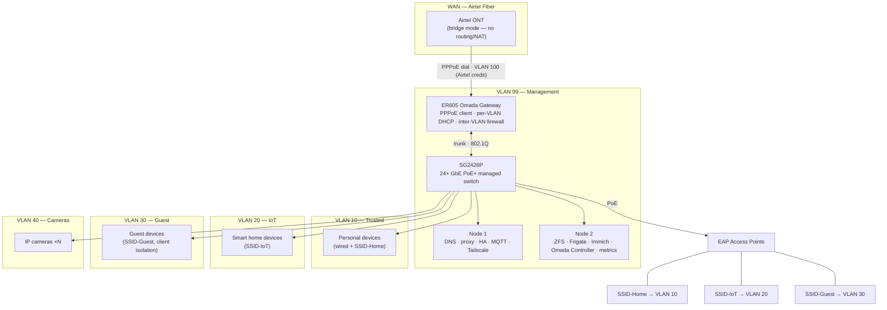
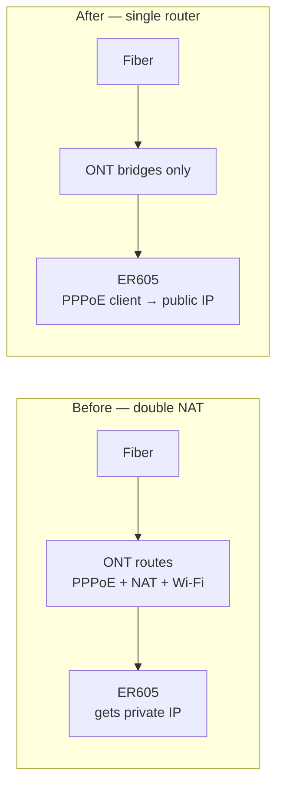

# Network Architecture

How the homelab is wired and segmented. The design goal: **the network must never depend on either server** — if Node 1 and Node 2 are both off, routing, DHCP, Wi-Fi and DNS fallback keep working.

## Topology

## WAN: PPPoE directly on the ER605

**Current state:** the ISP-provided ONT/router does everything — PPPoE dial, NAT, DHCP, Wi-Fi.

**Target state:** the ONT becomes a dumb bridge; the ER605 dials PPPoE itself. Airtel's PPPoE session is **VLAN-tagged (ID 100)** — the ER605 WAN1 interface must match whatever tagging the bridged ONT passes through (tagged VLAN 100 sub-interface, or untagged if the ONT strips the tag — verify against the ONT's bridge config/ISP docs).

Why it matters:

- **No double NAT** — port forwarding, P2P torrents, and inbound VPN work sanely.
- **One routing device** — firewall rules, VLANs and VPN endpoints live in one place instead of being split across two consumer firmwares.
- The ER605 has a built-in **WireGuard/OpenVPN client** — useful for site-to-site or a second remote-access path alongside Tailscale.

Steps:

1. Request **bridge mode** from the ISP (usually via their app/support). If refused, the fallback is ER605 WAN on the ONT's private subnet — everything still works, you just keep double NAT and must port-forward on both boxes.
2. Put the ONT in bridge mode; connect its LAN port to ER605 WAN1.
3. On the ER605: WAN1 → connection type **PPPoE**, VLAN ID **100** (Airtel), enter the ISP credentials → it gets the public IP.
4. Disable the ONT's Wi-Fi (or leave it off) — all Wi-Fi moves to the EAPs.

## VLAN plan

| VLAN | Name | Contents | DHCP | DNS handed out |
|---|---|---|---|---|
| 10 | Trusted | Personal devices, SSID-Home | ER605 | Node 1 + Node 2 (AdGuard) |
| 20 | IoT | Smart plugs, TVs, assistants — SSID-IoT | ER605 | Node 1 + Node 2 (AdGuard) |
| 30 | Guest | Guests — SSID-Guest, client isolation on | ER605 | Node 1 + Node 2 (AdGuard) |
| 40 | Cameras | IP cameras, wired only | none/static | none |
| 99 | Management | Node 1, Node 2, ER605, switch, EAPs | ER605 | Node 1 + Node 2 (AdGuard) |

Native VLAN on trunks: **99** (management), never user traffic.

SSID → VLAN binding happens on the EAPs in the Omada controller — one SSID per VLAN, no mixing.

## Inter-VLAN firewall rules (ER605)

| Source → Destination | Allowed |
|---|---|
| VLAN 99 (infra) | Everything — servers reach all VLANs |
| VLAN 10 (trusted) | Internet + all node services on 99 |
| VLAN 20 (IoT) | Internet + DNS 53 to Node 1 **and** Node 2 + MQTT 1883, HA 8123, Z2M 8099 on Node 1 + Immich 2283 on Node 2 |
| VLAN 30 (guest) | Internet only (+ DNS 53 to both nodes) — **no LAN access**, client isolation |
| VLAN 40 (cameras) | **Inbound from Node 2 only** — RTSP/HTTP camera ports (554, 8554, 8555). No internet, no other VLANs |
| Any → VLAN 99 mgmt ports | Denied except from 99 itself and established flows |

Camera rule detail: Frigate (Node 2, VLAN 99) *initiates* connections to cameras (VLAN 40), so the rule is written destination-first — VLAN 40 permits only return traffic plus management from 99 on the camera service ports. Cameras get no outbound internet at all (cloud-dependent cameras are the exception — whitelist their domains or move them to IoT).

## Switch port plan (SG2428P)

| Ports | Mode | VLANs |
|---|---|---|
| 1–2 | Trunk | 99 ↔ ER605 (all VLANs tagged) |
| 3–4 | Trunk | EAPs (all user VLANs tagged) |
| 5–6 | Access | Node 1, Node 2 → VLAN 99 |
| 7–10 | Access | Cameras → VLAN 40 |
| 11+ | Access/trunk | Spare devices, future expansion |

PoE budget: EAPs and cameras powered from the switch; nodes have their own PSUs.

## Omada Controller dependency

The controller runs on **Node 2 (VLAN 99)** and manages ER605 + SG2428P + EAPs.

- Controller **down** → switching, routing, DHCP, Wi-Fi and VLANs all keep working on last-known config. You only lose the web UI, stats and the ability to change config.
- This is why the controller is acceptable on the "heavy" node: it is a management plane, not a data plane.
- Adoption requirement: controller must be reachable on VLAN 99; set its inform URL to `http://$NODE2_IP:8088` (value from `node2/.env`) so devices find it after adoption.
- Controller software needs AVX (MongoDB 8) → Node 2 only, never Node 1.

### Can the Omada setup be scripted?

Mostly yes — but not through Ansible (that manages the nodes, not the network gear):

- **Open API (official, controller v5.9+):** enable under Global View → Settings → Platform Integration → Open API, create a Client ID/Secret. Covers sites, devices, WLAN groups/SSIDs, LAN networks, firewall rules, DHCP — read and write.
- **Terraform:** community `terraform-provider-omada` expresses VLANs, DHCP scopes, firewall rules, SSIDs and switch ports as code — the closest thing to full network-as-code.
- **Internal Web API v2 (undocumented):** covers the remaining bits (port profiles, mDNS) but uses a quirky triple-auth flow; community helper libs exist.
- **Manual once:** initial admin account + site creation, and device adoption (set the inform URL — devices then appear as pending and can be adopted via API/UI). After that, config changes are API-drivable.

## DNS resilience

Two AdGuard Home instances — **primary on Node 1, secondary on Node 2** — both on VLAN 99, both handed out by DHCP (DNS server 1 = Node 1, DNS server 2 = Node 2).

- **Why two:** if Node 1 reboots or fails, clients fail over to Node 2's instance instead of losing DNS entirely. Node 2 being the "heavy" node doesn't matter — AdGuard is ~100 MB RAM and DNS queries are trivial.
- **Config parity:** AdGuard has no built-in replication. Configure Node 1 fully, then Settings → export `AdGuardHome.yaml` and import it on Node 2 (all IPs/rewrites are identical on both). Re-export after changing rewrites/blocklists.
- **Upstreams:** Cloudflare over DoH (`https://dns.cloudflare.com/dns-query`) **plus** `tls://one.one.one.one` (DoT). AdGuard races upstreams per query and uses the fastest answer. DoT exists because Node 1's Athlon II has no AES-NI — pure-DoH cold lookups measured ~147 ms vs ~20 ms direct; DoT's lighter handshake lands ~30–50 ms. Encrypted hop from the LAN edge either way. Trade-off: queries leave your network to Cloudflare; a self-hosted upstream (Unbound + DNSSEC) or NextDNS are the privacy-heavier alternatives.
- **Blocklists:** HaGeZi Multi Pro (`adblock/pro.txt`) + the TiF threat-intel add-on (`adblock/tif.txt`), served via jsdelivr — see `node1/README.md` for exact URLs. They live inside `AdGuardHome.yaml`, so the Node 1 → Node 2 export/import keeps both instances identical.
- **Local names:** DNS rewrites map `node1.homelab` → Node 1 IP and `node2.homelab` → Node 2 IP on both instances — handy for SSH/browser access. `.env` IPs remain the source of truth (bootstrap/Ansible/DHCP reservations need them before DNS exists).
- **Firewall:** every user VLAN needs UDP+TCP 53 permitted to **both** node IPs — add this to the inter-VLAN rules or secondary DNS silently fails.
- **Fallback:** the ER605's own DNS forwarder stays configured upstream — covers the router itself and any client that bypasses DHCP DNS.

## Remote access overlay

Tailscale runs on both nodes (+ devices) as an overlay independent of VLANs/firewall — remote access to Node 1/Node 2 services works even if the WAN side changes. The ER605's built-in WireGuard client is a possible second path (e.g. site-to-site or a travel router).

## Design decisions (the "why" for interviews/README)

- **PPPoE on the ER605, not the ONT** — eliminates double NAT; one firewall, one VPN endpoint, one place for port rules.
- **VLAN segmentation** — least-privilege: cameras can't reach the internet or other VLANs, guests are isolated, IoT gets only the services it needs.
- **Servers on a management VLAN** — infrastructure is unreachable from user VLANs except through explicit firewall rules; Node 1/2 compromise doesn't hand over the LAN.
- **Dual AdGuard DNS (Node 1 primary, Node 2 secondary) + router fallback** — ad-blocking survives either server being down; encrypted upstream via Cloudflare DoH.
- **Omada controller on Node 2** — management plane only; data plane survives its downtime.
- **Tailscale overlay** — remote access decoupled from the physical topology and ISP.
